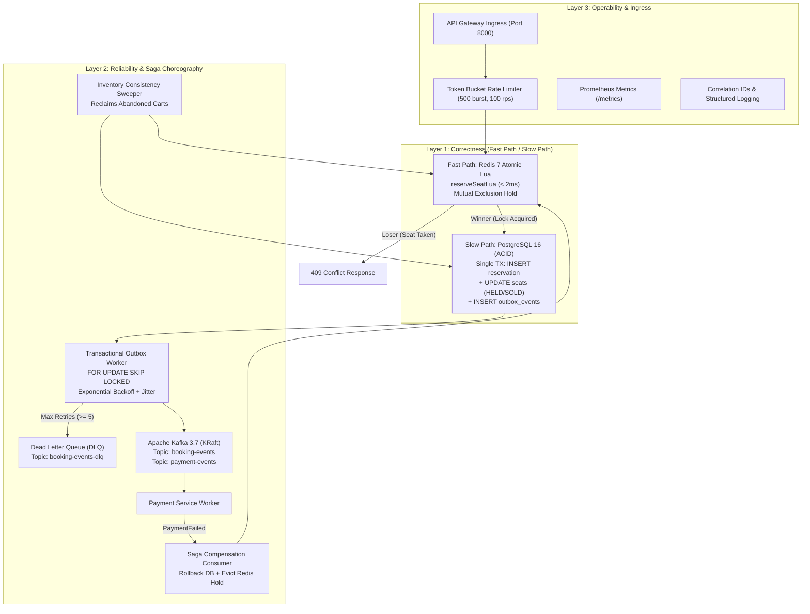

# Q-Sync: Distributed High-Concurrency Event Ticketing Platform

[](https://golang.org)
[](https://www.postgresql.org)
[](https://redis.io)
[](https://kafka.apache.org)
[](https://prometheus.io)
[](LICENSE)

**Q-Sync** is an enterprise-grade, distributed event ticketing platform built in Go, designed to handle flash-sale surges (e.g., 10,000+ users booking 500 seats simultaneously) without double-booking, race conditions, or service degradation.

Featuring an authentic consumer UI inspired by **BookMyShow** and **District (by Zomato)**, Q-Sync pairs a high-fidelity entertainment booking frontend with a mission-critical distributed backend.

---

## The 3 Production Layers



### 1. Correctness Layer (Zero Double-Booking Guarantee)
- **Fast-Path Distributed Locking**: Atomic Redis Lua scripts (`reserveSeatLua`) acquire mutual exclusion holds in `< 2ms` with TTL. Rejected requests immediately receive `409 Conflict / AlreadyExists` without touching the primary database.
- **Single-Transaction ACID Persistence**: Winning holds enter PostgreSQL in a single ACID transaction:
  1. `INSERT INTO reservations` with unique `idempotency_key` enforcement.
  2. `UPDATE seats SET status = 'HELD', version = version + 1 WHERE status = 'AVAILABLE'`.
  3. `INSERT INTO outbox_events` for transactional outbox dispatch.
- **PostgreSQL Ground-of-Truth Invariant**: If Redis restarts or partitions, the database enforces row-level optimistic versioning and status locking.

### 2. Reliability Layer (Retries, Recovery & Saga Choreography)
- **Event-Driven Saga Choreography**: Coordinates multi-service transactions across Booking and Payment workers via Apache Kafka.
- **Transactional Outbox Worker**: Polls `outbox_events` using `FOR UPDATE SKIP LOCKED` for concurrent at-least-once delivery.
- **Exponential Backoff with Full Jitter**: Transient network failures back off using randomized jitter:
  $$\text{Backoff} = \min(2^{\text{attempts}} \times 100\text{ms}) + \text{jitter}$$
- **Dead Letter Queue (DLQ)**: Poison pill events exceeding 5 retry attempts are routed to `booking-events-dlq` and flagged as `DEAD_LETTER` in PostgreSQL for auditing.
- **Automated Inventory Consistency Sweeper**: Background sweeper runs every 15 seconds to reclaim abandoned carts (`status = 'PENDING' AND expires_at < NOW()`), resets seats to `AVAILABLE`, and evicts lingering Redis locks.
- **Saga Compensation Consumer**: Subscribes to `PaymentFailed` events to rollback reservations and release Redis locks.

### 3. Operability Layer (Observability, Security & Ingress)
- **Token Bucket Rate Limiting**: In-memory token bucket limiter (500 burst capacity, 100 req/sec refill) on the API Gateway.
- **Prometheus Metrics**: Native metrics exposed on `/metrics` for latency percentiles, throughput, and error rates.
- **End-to-End Correlation IDs**: Trace requests across Gateway, gRPC, and Kafka using `X-Correlation-ID`.
- **Structured JSON Logging**: Standardized structured logging powered by Go `log/slog`.

---

## The 5 Production-Critical Flows

| Flow | Mechanism | Invariant |
|---|---|---|
| **1. Seat Reservation** | Fast-path Redis Lua lock (< 2ms) $\rightarrow$ Slow-path PostgreSQL ACID transaction | Winner claims seat; 999+ concurrent racers rejected with `409 Conflict`. |
| **2. Payment Confirmation** | Single DB transaction updates `reservations = 'CONFIRMED'`, `seats = 'SOLD'`, queues `BookingConfirmed` outbox | Only active, unexpired pending holds can be confirmed. |
| **3. Cancellation** | Evicts Redis Lua lock $\rightarrow$ DB updates `reservations = 'CANCELLED'`, `seats = 'AVAILABLE'` | Immediate inventory release for waiting customers. |
| **4. Payment Failure Compensation** | Kafka `PaymentFailed` event triggers Saga consumer rollback | Automated lock eviction & inventory restoration without manual intervention. |
| **5. Inventory Consistency Sweeper** | Periodic background sweep (`FOR UPDATE SKIP LOCKED`) of expired pending holds | Abandoned carts (TTL > 10m) automatically returned to the seat pool. |

---

## Microservices Fleet Architecture

| Service | Port | Protocol | Description |
|---|---|---|---|
| **API Gateway Router** (`cmd/gateway`) | `8000` | HTTP/REST | Public ingress, rate limiting, catalog proxy, booking coordination, `/metrics`. |
| **Catalog Discovery** (`cmd/catalog`) | `8082` | HTTP/REST | Event & seat metadata catalog protected by `singleflight` against cache stampedes. |
| **Booking Engine Core** (`cmd/booking`) | `50051` / `9090` | gRPC / HTTP | Core reservation engine, Redis locks, ACID DB, Outbox worker, Inventory Sweeper, Prometheus `/metrics`. |
| **Payment Saga Worker** (`cmd/payment`) | — | Kafka Event | Event-driven payment gateway simulation publishing `PaymentSucceeded` or `PaymentFailed`. |
| **Notification Service** (`cmd/notification`) | — | Kafka Event | Listens for `BookingConfirmed` to dispatch digital passes & M-Tickets. |

---

## BookMyShow & District App UI

Q-Sync serves an authentic, dark-themed entertainment booking UI directly on `http://localhost:8000/`:

* **Brand Header & City Selector**: Quick-switch between *Mumbai, Delhi-NCR, Bengaluru, and Hyderabad*.
* **Live Search**: Instant reactive filtering across titles, genres, artists, and venues.
* **Category Navigation Pills**: Filter by *Movies & IMAX, Concerts & Live, Standup Comedy, Sports & Stadiums*.
* **Spotlight Hero Carousel**: High-impact banner slider with verified rating ribbons (`★ 9.9/10 • 385K Votes`).
* **Curved Screen & Arena Seat Matrix**:
  * Realistic curved cinema projection graphic (*"All eyes this way • SCREEN / STAGE"*).
  * **Tiered Seating**:
    * 👑 **VIP Recliner / Lounge**: Rows A–B (plush wide seats with armrests)
    * 💎 **Platinum / Prime**: Rows C–E
    * ⭐ **Gold / Executive**: Rows F–H
    * 🎟️ **Silver / Classic**: Rows J–M
  * Real-time seat statuses: *Available*, *Selected* (neon glow), *Holding* (pulsing Redis lock), and *Sold*.
* **Slide-Over Checkout Drawer**:
  * Live 10-Minute Hold Countdown Timer (`09:59` synced with Redis lock TTL).
  * Itemized bill breakdown (tickets, convenience fee, GST).
  * F&B add-on combo toggle (*"Jumbo Caramel Popcorn + 2 Coke"*).
  * Instant UPI and Card payment methods triggering the real booking Saga.
* **Digital M-Ticket Pass**: Perforated stub styling, scannable QR Code, booking reference, and cancellation support.
* **⚡ Flash Engine HUD**: Built-in developer modal to trigger live 1,000-user concurrency benchmarks directly in the browser.

---

## Infrastructure Setup

Provision PostgreSQL, Redis, and Apache Kafka (KRaft mode):

```bash
docker-compose up -d
```

| Service | Port | Purpose |
|---|---|---|
| **PostgreSQL 16** | `5432` | ACID transactional persistence (bookings, seats, outbox) |
| **Redis 7** | `6379` | Distributed locking (atomic Lua seat hold with TTL) |
| **Apache Kafka 3.7** | `9092` | Event-driven Saga choreography (KRaft mode) |

Apply database schema & seed data:
```bash
docker exec -i qsync-postgres psql -U qsync -d qsync_db < deployments/migrations/000001_init_schema.up.sql
```

---

## Running the Platform

### 1. Launch Complete Microservices Fleet
Run all 5 microservices with automated health probe readiness:

```bash
go run ./cmd/fleet
```

Open in browser: **http://localhost:8000**

---

### 2. Prometheus Metrics Endpoints
* **API Gateway Ingress Metrics**: `http://localhost:8000/metrics`
* **Booking Engine Metrics**: `http://localhost:9090/metrics`

Key exposed metrics:
```text
qsync_booking_reservations_total{status="success|conflict|error"}
qsync_booking_reservation_duration_seconds{phase="redis_lock|db_write|total"}
qsync_booking_confirmations_total{status="success|not_found|error"}
qsync_booking_cancellations_total{reason="..."}
qsync_booking_active_holds
qsync_outbox_events_total{status="published|retry|dlq"}
qsync_inventory_expired_swept_total
```

---

### 3. Automated Unit & Concurrency Tests

Run automated concurrency invariant verification:
```bash
go test -v ./...
```

Expected output:
```text
=== RUN   TestHighConcurrencySeatReservation
    concurrency_test.go:172: Concurrency Stress Test Results:
    concurrency_test.go:173: Total Concurrent Requests: 1000
    concurrency_test.go:174: Success Count:            1
    concurrency_test.go:175: Already Locked Count:     999
    concurrency_test.go:176: Unexpected Errors:        0
--- PASS: TestHighConcurrencySeatReservation (0.02s)
PASS
ok      github.com/qsync/platform/test    2.172s
```

---

### 4. Live gRPC Flash-Sale Benchmark (1,000 Concurrent Goroutines)

In a separate terminal, launch a flash sale benchmark against a specific seat:

```bash
go run ./cmd/stress -c 1000 -seat seat-001 -event evt-coldplay-2026
```
